# System Architecture: SupplySense Nexus

## High-Level Architecture

```mermaid
graph TD
    subgraph "Frontend"
        A[HTML/CSS/JS Dashboard] --> B[Chart.js Visualizations]
        A --> C[AI Copilot Interface]
    end

    subgraph "Backend API Layer"
        D[FastAPI Application]
        D --> E[Health Router]
        D --> F[Data Router]
        D --> G[Forecast Router]
        D --> H[Supplier Router]
        D --> I[Scenario Router]
        D --> J[Decision Router]
        D --> K[Optimization Router]
        D --> L[AI Assistant Router]
        D --> M[Governance Router]
    end

    subgraph "Core Services"
        N[Data Foundation]
        O[Demand Intelligence]
        P[Inventory Intelligence]
        Q[Supplier Intelligence]
        R[Risk Graph]
        S[Disruption Lab]
        T[Decision Replay Lab]
        U[Optimization Engine]
        V[AI Decision Copilot]
        W[Governance Engine]
    end

    subgraph "Data Layer"
        X[PostgreSQL Database]
        Y[Model Registry]
        Z[Audit Logs]
    end

    subgraph "Analytics"
        AA[Pandas/NumPy]
        AB[Scikit-learn]
        AC[Statsmodels]
        AD[OR-Tools]
    end

    A --> D
    D --> N
    D --> O
    D --> P
    D --> Q
    D --> R
    D --> S
    D --> T
    D --> U
    D --> V
    D --> W
    N --> X
    O --> X
    P --> X
    Q --> X
    R --> X
    S --> X
    T --> X
    U --> X
    V --> X
    W --> X
    O --> AA
    O --> AB
    O --> AC
    U --> AD
    V --> X
    W --> Y
    W --> Z
```



## Component Responsibilities

### Backend (FastAPI)
- REST API serving all platform modules
- Request validation via Pydantic schemas
- Authentication and authorization boundaries
- CORS handling for frontend integration
- Health monitoring and readiness probes

### Data Foundation
- Manages all entity data: products, suppliers, inventory, warehouses
- Handles data ingestion and validation
- Tracks data lineage and source labels
- Enforces referential integrity

### Demand Intelligence
- Historical demand analysis and preprocessing
- Feature engineering for forecasting
- Model training and comparison
- Prediction interval generation
- Model drift detection

### Inventory Intelligence
- Real-time inventory position calculation
- Safety stock and reorder point computation
- Stockout and overstock risk estimation
- Days-of-supply and turnover analysis

### Supplier and Procurement Intelligence
- Supplier scorecard generation
- Performance metric aggregation
- Alternative supplier analysis
- Total cost of ownership calculation

### Supply-Chain Risk Graph
- Relational representation of dependencies
- Critical component identification
- Disruption impact propagation
- Concentration analysis

### Disruption and Scenario Lab
- Scenario definition and event modeling
- Monte Carlo simulation
- Sensitivity analysis
- Combined disruption modeling

### Decision Replay Lab
- Baseline and alternative scenario comparison
- Decision option evaluation
- Cost, service, risk, and inventory impact analysis
- Recommendation ranking with confidence
- Assumption and reproducibility tracking

### Optimization Engine
- Constraint-based optimization (OR-Tools)
- Multi-objective trade-off analysis
- Supplier selection and procurement quantity optimization
- Budget, capacity, MOQ, lead-time, service-level enforcement

### AI Decision Copilot
- Natural-language intent classification
- Controlled tool registry
- Read-only analytical queries
- Evidence-backed responses with citations
- Confidence and uncertainty expression
- Human approval workflow for consequential actions

### Governance Engine
- Data-quality reporting
- Model registry and versioning
- Backtesting framework
- Drift monitoring
- Audit logging and traceability

## Backend Structure

```
backend/app/
├── __init__.py
├── main.py                    # FastAPI application entry point
├── core/
│   ├── __init__.py
│   ├── config.py              # Pydantic settings
│   ├── database.py            # SQLAlchemy async engine and sessions
│   └── security.py            # Authentication utilities
├── models/                    # SQLAlchemy ORM models
│   ├── __init__.py
│   ├── user.py
│   ├── product.py
│   ├── inventory.py
│   ├── supplier.py
│   ├── ...
├── schemas/                   # Pydantic request/response schemas
│   ├── __init__.py
│   ├── product.py
│   ├── inventory.py
│   ├── ...
├── api/                       # FastAPI routers
│   ├── __init__.py
│   ├── health_router.py
│   ├── data_router.py
│   ├── forecast_router.py
│   ├── supplier_router.py
│   ├── scenario_router.py
│   ├── decision_router.py
│   ├── optimization_router.py
│   ├── ai_router.py
│   └── governance_router.py
├── integration/               # External system integrations
│   ├── __init__.py
│   ├── llm_provider.py        # LLM abstraction layer
│   └── data_source.py         # Data source connectors
├── analytics/                 # ML and analytics logic
│   ├── __init__.py
│   ├── forecasting.py         # Forecasting pipeline
│   ├── optimization.py        # Optimization pipeline
│   └── simulation.py          # Simulation pipeline
├── tests/                     # pytest test suite
│   ├── __init__.py
│   ├── test_health.py
│   ├── test_data.py
│   └── ...
└── migrations/                # Alembic database migrations
    ├── env.py
    ├── script.py.mako
    └── versions/
```

## Data Flow

1. **Data Ingestion**: External data sources feed into PostgreSQL tables via API or direct import.
2. **Data Quality**: Ingested data passes through validation rules; failures are logged.
3. **Analysis**: Analytics modules query validated data, perform computations, and store results.
4. **API Serving**: Frontend and downstream systems query the API for results.
5. **AI Copilot**: User queries are classified, tools are called, evidence is retrieved, and responses are generated.
6. **Audit**: All significant operations are logged to the audit trail.

## Frontend Structure

```
frontend/
├── index.html                 # Main landing page
├── static/
│   ├── css/
│   │   └── style.css          # Responsive dashboard styles
│   └── js/
│       └── app.js             # Frontend application logic
└── templates/                 # Future Jinja2 templates (if needed)
```

## ML Lifecycle

1. **Data Preparation**: Load historical demand, clean, normalize, and split temporally.
2. **Feature Engineering**: Create lag features, rolling statistics, calendar features, and external regressors.
3. **Model Training**: Train baseline models (naive, seasonal naive, moving average, exponential smoothing) and ML models (gradient boosting, random forest).
4. **Time-Based Validation**: Walk-forward validation with expanding training window.
5. **Evaluation**: Compute MAE, RMSE, MAPE, sMAPE, and WMAPE. Compute prediction intervals.
6. **Model Selection**: Compare models on validation metrics; select best performer.
7. **Deployment**: Register model version; schedule periodic retraining.
8. **Monitoring**: Track drift, forecast accuracy degradation, and data distribution changes.

## Optimization Lifecycle

1. **Problem Definition**: Define objective (cost minimization, service maximization, or multi-objective).
2. **Constraint Specification**: Set MOQ, budget, capacity, lead-time, and service-level constraints.
3. **Model Construction**: Build constraint optimization model using OR-Tools.
4. **Solving**: Run solver to find feasible and optimal solutions.
5. **Multi-Objective Analysis**: Generate Pareto front and trade-off curves.
6. **Result Presentation**: Present options with cost, service, and risk metrics.

## Simulation Lifecycle

1. **Scenario Definition**: Define disruption event type, magnitude, and duration.
2. **Monte Carlo Sampling**: Draw random samples from probability distributions.
3. **Impact Propagation**: Simulate the effect through the supply-chain network.
4. **Aggregation**: Compute expected values, confidence intervals, and sensitivity metrics.
5. **Reproducibility**: Use fixed random seeds for all simulations.

## AI Assistant Lifecycle

1. **Intent Classification**: Classify user query into predefined intent categories.
2. **Tool Selection**: Map intent to registered tools (read-only analytics plus labeled compute tools; the mutation category is empty).
3. **Evidence Retrieval**: Execute tools to fetch data, forecasts, risk scores, and supplier metrics.
4. **Response Construction**: Build response with citations, confidence levels, and limitations.
5. **Audit Logging**: Record the query, tools called, and response.
6. **Human Approval**: For consequential actions, the copilot declares the action; a manager+ user records an approve/reject decision that is never executed by the assistant.

## Authentication Boundary

- All API endpoints require authentication except health endpoints.
- Opaque Bearer API keys (`ssk_...`): only the SHA-256 hash is stored, compared with `hmac.compare_digest`; missing/unknown/deactivated keys all return the same 401. No JWT, no login endpoint, identity never taken from the request body.
- Role-based access control: analyst, planner, manager, executive, admin.
- AI assistant operations are restricted by role permissions (chat/tools: analyst+; approval decisions: manager+; admin bypasses).
- Rate limiting: per-role in-process tiers return 429 + `Retry-After`; the limiter fails open on internal fault while authentication fails closed.

## Authorization Boundary

- Users can only access data within their organization.
- AI assistant has read-only access to analytical data.
- Procurement actions require explicit human approval.
- Governance actions are restricted to admin roles.

## Audit Boundary

- All API requests are logged with user ID, timestamp, endpoint, and parameters.
- AI tool calls are logged with inputs, outputs, and confidence.
- Decision Replay Lab actions are logged with full assumption and parameter snapshots.
- Audit logs are append-only and immutable.

## Error-Handling Strategy

- **API Layer**: Consistent error response format with error codes and messages.
- **Database Layer**: Connection pooling with retry logic; graceful degradation.
- **ML Layer**: Model failure falls back to baseline; errors logged and alerted.
- **AI Layer**: LLM failures return "unavailable" with explanation; never fabricate.
- **Validation Layer**: Input validation errors returned with specific field details.
- **Rate Limiting**: Per-user rate limits to prevent abuse.

## Observability Strategy

- **Logging**: Structured JSON logs with request ID, user ID, timestamp, and operation.
- **Metrics**: Request latency, error rates, model accuracy, and system health.
- **Tracing**: Correlation IDs across service boundaries.
- **Alerting**: Threshold-based alerts for data quality, model drift, and system errors.
- **Dashboard**: Basic health and operational metrics dashboard.

## Deployment Approach

- **Local Development**: Docker Compose for PostgreSQL; uvicorn for the FastAPI server.
- **CI/CD**: GitHub Actions for testing and linting when implementation begins.
- **Containerization**: Docker images for the backend and PostgreSQL.
- **No Kubernetes**: Single-container deployment suffices for portfolio scale.
- **Environment Management**: `.env` files for configuration; separate environments for dev/test/prod.

## Future Extension Points

- **Kubernetes**: Replace Docker Compose for orchestration at scale.
- **Kafka**: Add event streaming for real-time data pipelines.
- **Graph Database**: Migrate risk graph to Neo4j if relationship complexity grows.
- **Reinforcement Learning**: Replace statistical methods with RL for dynamic policies.
- **Multi-Agent Orchestration**: Expand AI assistant to specialized sub-agents.
- **XGBoost**: Add gradient boosting models for improved forecast accuracy.
- **Great Expectations**: Upgrade data-quality validation to a full framework.
